# PDF Policy RAG Assistant

A compact, end-to-end Retrieval-Augmented Generation (RAG) demo for answering employee policy questions from a PDF. The project is designed as a clear portfolio example of document ingestion, semantic search, source-grounded answering, and containerized delivery.

> **Demo only:** The included policy document contains fictional company information. Do not use confidential client or employee data without appropriate access controls and data-protection measures.

## Demo



The animation shows the typical flow: an employee question, policy retrieval, and a source-grounded answer.

## What it does

1. Creates a sample employee-policy PDF.
2. Extracts readable text from the PDF with `pypdf`.
3. Converts the extracted text into embeddings with SentenceTransformers.
4. Stores and searches the embeddings in a local ChromaDB vector database.
5. Retrieves the most relevant policy text for an employee question.
6. Optionally uses a local Ollama model to generate a concise answer from retrieved sources only.

## Architecture

```text
Employee question
       |
SentenceTransformer embedding
       |
ChromaDB semantic retrieval
       |
Relevant PDF text + page metadata
       |
Optional local LLM (Ollama)
       |
Source-grounded answer
```

## Tech stack

- **Python** - application logic
- **pypdf** - PDF text extraction
- **SentenceTransformers** - local embedding generation
- **ChromaDB** - persistent vector storage and semantic search
- **Ollama** (optional) - local answer generation
- **Docker** - reproducible runtime environment

## Quick start

### Prerequisites

- Python 3.12 or later
- Docker Desktop (optional)
- Ollama (optional, for generated answers)

### Run locally

```powershell
git clone https://github.com/mahersheikhi/PDF-based-RAG-assistant.git
cd PDF-based-RAG-assistant

python -m venv .venv
.\.venv\Scripts\Activate.ps1
pip install -r requirements.txt

python create_demo_pdf.py
python rag_pdf_assistant.py
```

Try questions such as:

```text
How do I reset my password?
How many vacation days do I receive?
What is the remote-work policy?
When do I need manager approval for an expense?
```

Type `exit` to close the assistant.

## Optional: local LLM answers

The application works without an LLM and prints the retrieved policy text. To generate a natural-language answer locally:

```powershell
ollama pull qwen2.5:3b
```

Then set the following value in `rag_pdf_assistant.py`:

```python
USE_LLM = True
```

The prompt instructs the model to answer only from retrieved source text and to cite the relevant PDF page.

## Docker

Build and run the project in a container:

```powershell
docker build -t pdf-policy-rag-assistant .
docker run -it --rm -v "${PWD}/chroma_data:/app/chroma_data" pdf-policy-rag-assistant
```

The volume keeps the ChromaDB data between container runs. For Ollama running on the host, Docker Desktop exposes it through `host.docker.internal:11434`.

## Project structure

```text
.
├── create_demo_pdf.py      # Creates the fictional employee-policy PDF
├── rag_pdf_assistant.py    # Interactive PDF RAG assistant
├── requirements.txt        # Python dependencies
├── Dockerfile              # Container definition
└── README.md               # Project documentation
```

## Future improvements

- Split longer documents into overlapping chunks instead of one chunk per page.
- Add metadata filters for department, document version, and access permissions.
- Show source snippets and similarity scores in the response.
- Add automated evaluation with representative employee questions.
- Build a Streamlit or FastAPI interface.
- Add authentication, audit logs, and monitoring for production use.

## Why this project

This demo illustrates the practical core of a company-document assistant: retrieve relevant information first, then generate an answer that remains grounded in those sources. It also highlights the difference between a simple RAG workflow and a fully autonomous agent.

## License

This project is intended for demonstration and portfolio purposes.
